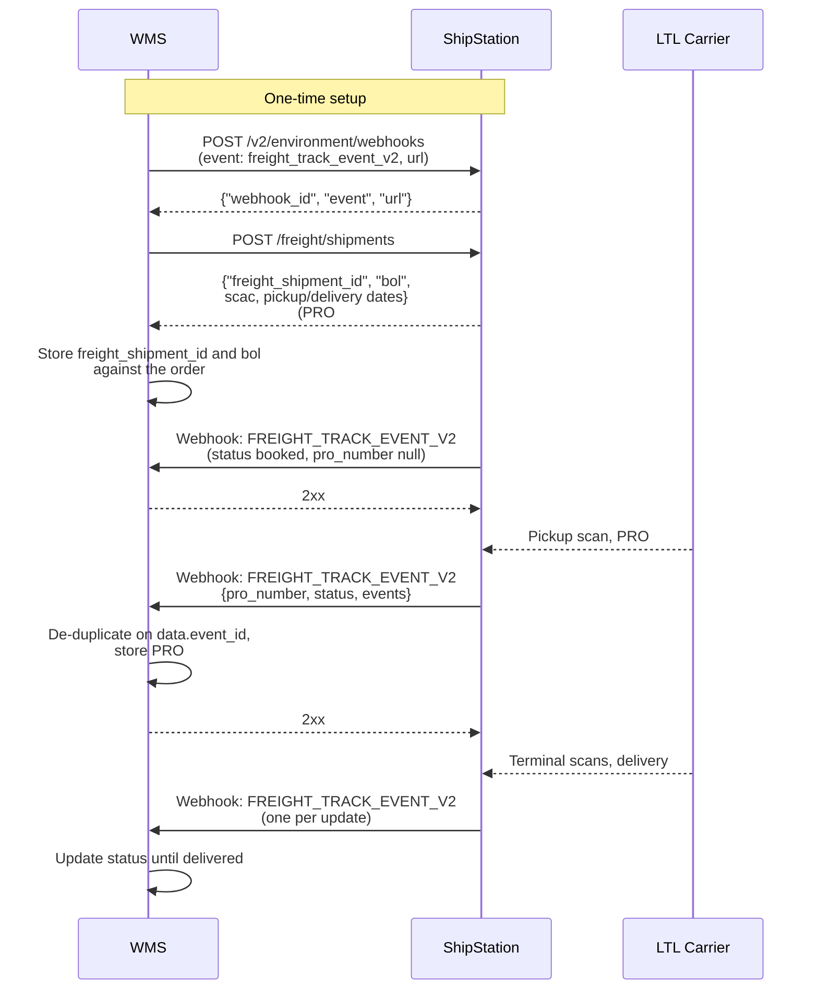

# Freight Shipment Tracking and PRO# Retrieval

## Overview

Subscribe to the `freight_track_event_v2` webhook once. After that, ShipStation pushes a `FREIGHT_TRACK_EVENT_V2` event to your endpoint each time the carrier reports a new status for a freight shipment booked through ShipStation. Each push carries the current status, the full tracking history and the `pro_number`, so your system doesn't need to call the tracking endpoint.

This matters most when the PRO# isn't known at booking, for example with carriers that don't support e-PROs. The booking response (`POST /freight/shipments`) may return a `null` PRO#. The webhook delivers it as soon as the carrier reports it.

## Flow

## References

- Official docs: [Freight tracking webhooks](https://docs.shipstation.com/freight/manage-shipments#freight-tracking-webhooks)
- Official docs: [Webhook payload schemas (Freight Tracking Event)](https://docs.shipstation.com/apis/docs/guides/webhooks-schemas#webhook-event-payloads)
- Official docs: [POST /v2/environment/webhooks](https://docs.shipstation.com/apis/openapi/webhooks/create_webhook)
- Official docs: [POST /freight/shipments](https://docs.shipstation.com/apis/openapi/freight/book_freight_shipment)
- Official docs: [GET /freight/shipments/{freight_shipment_id}/documents](https://docs.shipstation.com/apis/openapi/freight/list_freight_shipment_documents)
- Webhook creation: [`webhook setup/webhook-creation.md`](../webhook%20setup/webhook-creation.md)
- Real payloads: [`webhooks/tracking-v2/freight/`](../../webhooks/tracking-v2/freight/README.md)

## Notes

- **Setup**: create the webhook once with `event` set to `freight_track_event_v2` and your listener `url`. It can only be created through the API. Add a `store_id` to receive only that store's shipments; a shipment with no store reaches only webhooks that aren't scoped to a store.
- **Match events to orders** with `data.freight_shipment_id` or `data.bol_number`, both from the booking response, or with `data.shipment_number`, your own reference. Keep these against the order when you book.
- **The PRO# arrives with the first carrier scan, which is after pickup.** In the captured example it was `null` at booking and appeared about 16 hours later, in the same update as the pickup scan. There was no webhook in between. So the webhook can't give you a PRO# ahead of pickup. Treat `pro_number` as nullable on every event and keep the last non-null value.
- **De-duplicate on `data.event_id`.** It is stable for a given update, so a redelivered webhook carries the same value. If your endpoint doesn't return a `2xx` in time, ShipStation retries, and in the capture each update arrived three times. If your endpoint was down, an older update's retry can arrive after a newer one, so don't let it overwrite newer state. Compare `data.updated_at`, or the length of `data.events`.
- **Reply `2xx` quickly**, then process. Don't do the work before acknowledging.
- **`events` is cumulative.** Every push re-sends the full history, newest first, so one push can carry more than one new scan. The first two events are generated by ShipStation (`created`, `pending_pickup`) and have no carrier code or description.
- **Status**: `data.status` (`booked`, `in_transit`, `delivered`) and `data.tracking_status` (`pending_pickup`, `in_transit`, `delivered`) are separate fields. Exception and delay values haven't been captured, so don't treat these lists as complete.
- **Don't rely on `data.estimated_delivery_date`.** In the capture it was set at booking and never updated, even when the shipment arrived days later.
- **Timestamps**: on carrier scans `occurred_at` was observed to be 8 hours behind the true UTC instant, the Pacific clock time with a `Z` on it. `updated_at` and the ShipStation-generated events appear to be real UTC. Use the array order rather than sorting on `occurred_at`. See the folder README linked above; this is observed behaviour and hasn't been confirmed with ShipStation.
- **What isn't in the payload**: scan locations, a delivery date field and any documents. For the proof of delivery, call `GET /freight/shipments/{freight_shipment_id}/documents`.
- **The delivered event can arrive late.** In the capture it arrived about 22 hours after the carrier's delivery scan. Don't depend on it in real time.
- **Only ShipStation-booked freight triggers this webhook.** To track freight booked elsewhere, use [`GET /freight/tracking`](./track-freight.md), which has no webhook.
- **If you can't receive webhooks**, poll `GET /freight/shipments/{freight_shipment_id}/tracking` once or twice a day instead.
- Sync the PRO#, status and delivery details back to your order source system or WMS dashboard for fulfillment visibility.
